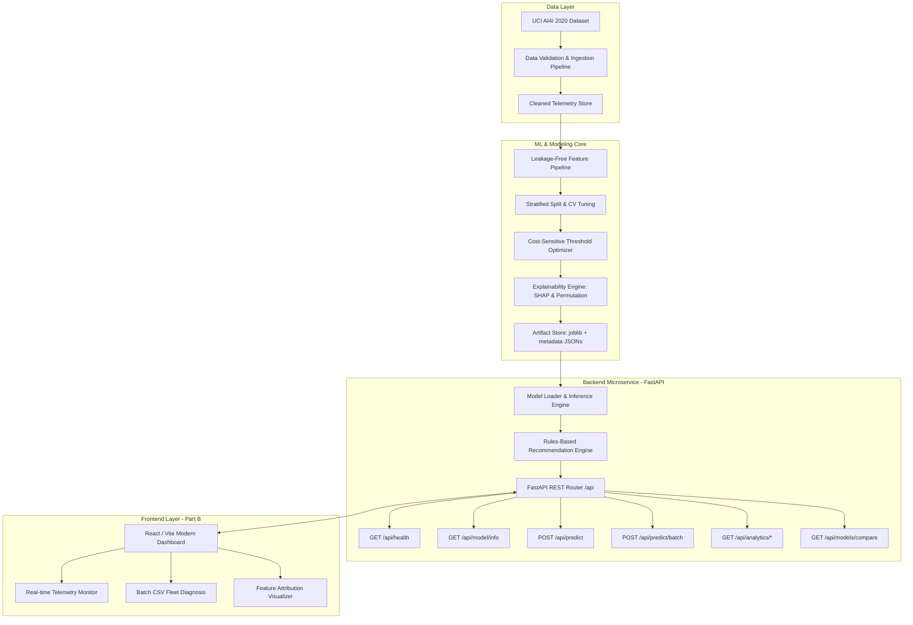

# PULSE Architecture Documentation

## 1. System Overview

PULSE (Industrial Intelligence & Predictive Maintenance Platform) is an academic and enterprise-grade predictive maintenance architecture built to detect machine failure precursors before catastrophic downtime occurs.

## 2. Component Design

### 2.1 Preprocessing & ML Pipelines
- Implemented strictly with `scikit-learn` `Pipeline` and `ColumnTransformer` to guarantee zero data leakage between training and validation/test folds.
- Categorical features (`Type` in {'L', 'M', 'H'}) are one-hot encoded without arbitrary ordinal assumptions.
- Numerical features are normalized via standard scaling inside the cross-validation estimators.
- Feature Engineering extracts domain-specific physics indicators:
  - `temp_diff`: Difference between Process Temperature and Air Temperature ($T_{process} - T_{air}$).
  - `power_kW`: Mechanical power approximation derived from rotational speed and torque ($P = \frac{2\pi \cdot \omega \cdot \tau}{60,000}$).
  - `torque_wear_interaction`: Mechanical strain indicator ($\tau \cdot \text{tool wear}$).
  - `temp_ratio`: Thermal ratio ($T_{process} / T_{air}$).

### 2.2 Inference Engine
- Models are loaded as immutable serialized artifacts on startup into memory.
- Predictions produce calibrated or raw probability estimates $P(\text{failure} \mid X)$.
- Custom risk thresholds partition probability into distinct risk levels:
  - `LOW`: $P < \theta_{alert} / 2$
  - `MEDIUM`: $\theta_{alert} / 2 \le P < \theta_{alert}$
  - `HIGH`: $\theta_{alert} \le P < 0.80$
  - `CRITICAL`: $P \ge 0.80$

### 2.3 Physics-Guided Maintenance Recommendation Engine
PULSE pairs statistical ML predictions with rule-based industrial heuristic checks:
1. **Thermal Dissipation Check**: Triggered if $T_{process} - T_{air} < 8.6\text{ K}$ and $\omega < 1380\text{ rpm}$.
2. **Mechanical Overstrain Check**: Triggered if $\tau \cdot \text{tool wear} > 11,000\text{ Nm}\cdot\text{min}$ (Type L) or $> 12,000$ (Type M/H).
3. **Power Overload Check**: Triggered if mechanical power exceeds $9.0\text{ kW}$ or drops below $3.5\text{ kW}$ under load.
4. **Tool Replacement Advisory**: Triggered if tool wear exceeds $200\text{ minutes}$.

---

## 3. Deployment & Scalability Characteristics
- **Stateless REST backend**: Enables horizontal autoscaling across multi-worker Uvicorn processes or containerized Kubernetes pods.
- **Resource Footprint**: Highly optimized for resource-constrained edge machines (Apple Silicon M1, 8GB RAM, and free Colab environments).
