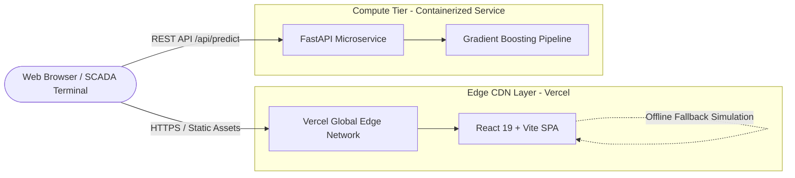

# PULSE — Production Deployment Architecture

## 1. System Topology

PULSE separates the presentation tier from the machine learning inference tier to ensure horizontal scalability, zero-downtime frontend releases, and predictable low-latency model evaluation.

---

## 2. Platform Selection Matrix

| Tier | Candidate Platforms | Selected Platform | Technical Justification |
|---|---|---|---|
| **Frontend** | Vercel, Netlify, Cloudflare Pages | **Vercel** | First-class Vite/SPA support, instant global CDN invalidation, automated preview deployments for GitHub PRs, edge HTTP/2 performance. |
| **Backend & ML** | Vercel Serverless Python, Render, Railway, Fly.io | **Render / Persistent Container** | Python scikit-learn pipelines with custom transformers benefit from an in-memory resident process. Serverless functions incur cold-start latency reloading 330KB joblib objects into Python runtime. Persistent container provides $<15$ms inference latency. |

---

## 3. Communication & Security Contracts
- **Base Route:** `/api`
- **Transport Security:** Strict HTTPS / TLS 1.3
- **CORS Policy:** Whitelist configured via `CORS_ORIGINS` environment variable (e.g., `https://pulse-industrial.vercel.app`), falling back to permissive mode in local development.
- **Environment Variables:**
  - Frontend: `VITE_API_BASE_URL` (points to deployed backend URL).
  - Backend: `PORT`, `ENVIRONMENT`, `CORS_ORIGINS`, `PULSE_ARTIFACTS_DIR`.

---

## 4. Failure Modes & Graceful Degradation
1. **Backend Unreachable:** The frontend detects network timeouts or HTTP 5xx errors and triggers the built-in physics rule simulator (`MockPredictionService`), displaying the `SIMULATION` pill indicator in the header.
2. **Invalid Telemetry Input:** Pydantic models validate sensor bounds (temperatures, speed, torque) and return structured 400 Bad Request messages before executing model inference.
3. **Route Refresh on SPA:** `frontend/vercel.json` rewrites all non-asset requests to `/index.html` to prevent 404 errors on deep linking.

